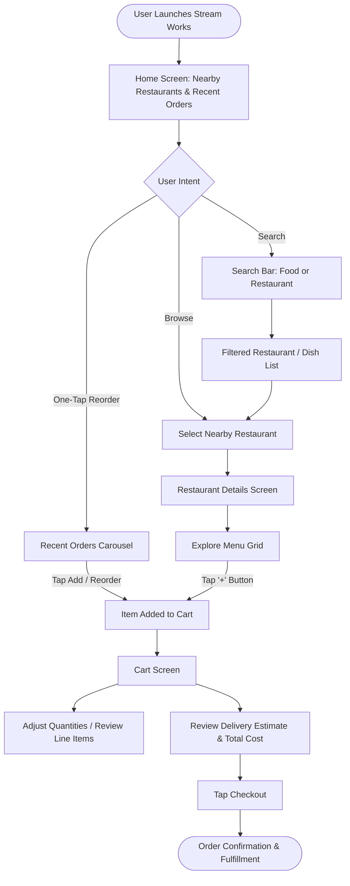
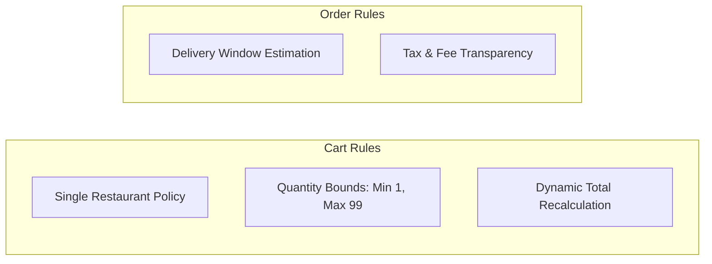
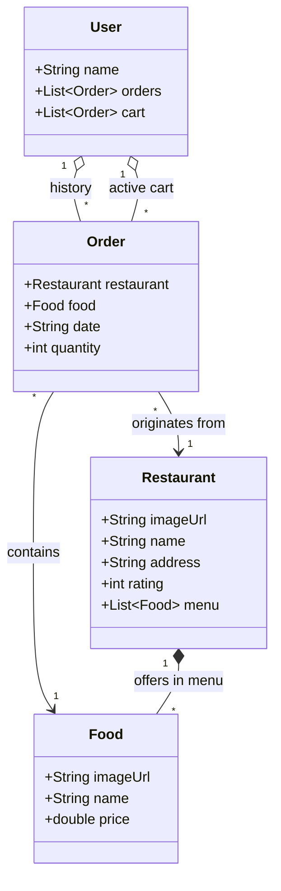

# Business Requirement Specification (BRS)
## Project: Stream Works (POS - Point of Sale)

---

### Document Control & Version History

| Version | Date | Author / Contributor | Description of Changes | Status |
| :--- | :--- | :--- | :--- | :--- |
| **1.0.0** | October 18, 2026 | System Architecture & Business Analysis Team | Initial formalization of Business Requirement Specification derived from the Stream Works mobile client application code base. | **Approved / Baseline** |

---

## 1. Executive Summary & Project Overview

### 1.1 Purpose
The purpose of this Business Requirement Specification (BRS) is to formalize and document the complete functional, non-functional, and operational business requirements for **Stream Works** (internal code: `pos`). Stream Works is an on-demand food discovery, mobile ordering, and delivery platform that bridges local restaurant merchants, hungry consumers, and courier fulfillment networks into a seamless digital ecosystem.

### 1.2 Problem Statement & Market Opportunity
Modern dining habits demand hyper-convenient, location-aware food ordering with minimal checkout friction. Consumers often abandon orders when discovery is cluttered, reordering favorite dishes requires repeated manual searching, or delivery timelines and pricing calculations are opaque. Stream Works addresses these challenges by offering:
- **Instant Reordering**: Instant one-tap access to recent orders.
- **Proximity-First Discovery**: Geolocation-aware prioritization of local culinary partners.
- **Transparent Ordering & Cart Calculation**: Clear breakdown of dish pricing, item quantities, estimated delivery time, and real-time total updates.
- **Visual-First Menu Browsing**: Rich, high-fidelity imagery with intuitive visual overlays.

### 1.3 Project Scope
* **In-Scope (Core Platform Baseline)**:
  * Customer-facing multi-platform client (Flutter for iOS, Android, and Web).
  * Restaurant discovery, category and text-based search, and real-time geodesic proximity calculation (`geolocator` and PostGIS spatial engine).
  * Restaurant profile visualization, address verification, and star rating analytics.
  * Menu catalog browsing with dish details, unit pricing, and visual presentation.
  * One-tap reorder carousel with chronological history.
  * Shopping cart state management, quantity increment/decrement, line-item subtotaling, and real-time grand total aggregation.
  * Single-merchant cart policy enforcement (BR-01) and quantity boundary limits 1–99 (BR-02).
  * Integrated Stripe payment gateway with integer-cents currency calculations and 3D Secure verification.
  * Real-time courier telemetry gateway and live delivery tracking screen with animated lifecycle stepper.
  * Server-side cryptographic webhook reconciliation with HMAC-SHA256 signature verification and idempotency ledger.
  * Offline caching and network resilience (`CachedRestaurantRepository`).
  * Hardware-backed Platform Keychain storage (`flutter_secure_storage`).
* **Future Scope (Strategic Horizons)**:
  * Merchant management portal and Kitchen Display System (KDS) for tablet order acceptance and inventory 86-ing.
  * Dedicated Courier mobile app for turn-by-turn navigation and delivery verification.
  * Customer loyalty points, promo code engine, and dynamic surge delivery pricing.
  * Multi-merchant batch dispatching and automated courier fleet optimization.

---

## 2. Stakeholders & User Personas

| Stakeholder Role | Description | Primary Goals & Value Drivers |
| :--- | :--- | :--- |
| **End Customer (Eater)** | Individual consumer using mobile or web application to order meals. | Fast discovery, effortless reordering, clear pricing, accurate delivery estimates. |
| **Merchant / Restaurant Partner** | Kitchen staff, managers, and restaurant owners listing their menus. | Expanding reach, increasing order volume, managing menu availability and reviews. |
| **Delivery Courier** | Contracted drivers/riders transporting orders from restaurants to consumers. | Route efficiency, transparent tips, rapid hand-off and delivery verification. |
| **Platform Administrator** | Stream Works business operations, support, and technical personnel. | System uptime, fraud mitigation, dispute resolution, partner onboarding, business analytics. |

### Persona Profile: The Repeat Consumer ("Rebecca")
* **Profile**: Working professional ordering meals during lunch hours or after work.
* **Key Behavior**: Reorders habitual favorite meals (e.g., Ramen from Restaurant 0, Burritos from Restaurant 1, Steaks from Restaurant 2).
* **Pain Points**: Re-entering items manually, confusing cart adjustments, unexpected delivery delays.
* **Key Metric**: Time-to-order (< 60 seconds from app launch to checkout).

---

## 3. Business Objectives & Success Metrics (KPIs)

| Objective | Metric / KPI | Target Benchmark |
| :--- | :--- | :--- |
| **Accelerate Reordering Velocity** | Time-to-Reorder via "Recent Orders" | < 45 seconds average |
| **Improve Order Completion Rate** | Cart-to-Checkout Conversion Rate | $\ge 70\%$ |
| **Minimize Search Drop-off** | Search-to-Menu-Click Conversion | $\ge 65\%$ |
| **Customer Retention** | Repeat Order Rate within 30 Days | $\ge 40\%$ |
| **App Performance & Responsiveness** | Screen Transition Time & Image Load | $< 1.5\text{ seconds}$ on 4G networks |

---

## 4. End-to-End Business Processes & User Journeys



### 4.1 Process 1: Restaurant Discovery & Proximity Browsing
1. User opens the application and is presented with their primary navigation header displaying their profile shortcut and active Cart counter badge.
2. The system computes nearby culinary establishments based on customer coordinates (e.g., `0.2 miles away`).
3. Each restaurant listing summarizes primary branding, cover imagery, star rating (1–5 scale), physical location address, and travel distance.
4. Tapping any restaurant initiates a seamless Hero animation transitioning into the full Restaurant Details screen.

### 4.2 Process 2: Quick Reorder from Historical Purchases
1. The Home screen immediately showcases a horizontally scrollable carousel of recent orders (`currentUser.orders`).
2. Each order card displays the dish photograph, dish name, restaurant origin, purchase date, and an accessible add-to-cart action button.
3. Tapping the add action replicates the prior order item directly into the active shopping cart without requiring deep menu traversal.

### 4.3 Process 3: Menu Item Selection & Cart Additions
1. In the Restaurant screen, the customer accesses contact info, reviews, location details, and a 2-column menu grid.
2. Dishes highlight high-resolution food imagery, dish title, and formatted base price (e.g., `$14.99`).
3. Tapping the add-to-cart button adds the selected item into `currentUser.cart`, automatically incrementing the cart badge counter on the navigation bar.

### 4.4 Process 4: Cart Management & Order Finalization
1. The user navigates to the Cart screen via the top-bar button (`Cart (N)`).
2. The user reviews each item's thumbnail, item name, restaurant name, quantity, and computed line-item total (`quantity * unit price`).
3. The user can increment (`+`) or decrement (`-`) item counts. If an item reaches 0, it is removed from the cart.
4. The system calculates and displays the Estimated Delivery Time (e.g., `25 min`) and dynamic Grand Total formatted in currency.
5. The user confirms their purchase by clicking the prominent `CHECKOUT` action bar.

---

## 5. Detailed Functional Requirements (FR)

### 5.1 Account & Identity Management (AIM)

| Req ID | Requirement Description | User Action / Trigger | Expected System Behavior | Priority |
| :--- | :--- | :--- | :--- | :--- |
| **FR-AIM-01** | User Profile Access | User taps profile icon (`Icons.account_circle`) on Home AppBar. | Open user account drawer / profile management screen displaying customer name, saved addresses, and payment methods. | Should Have |
| **FR-AIM-02** | User Order History Storage | App initializes or user completes an order. | Maintain an indexed list of historical purchases (`orders`) with food item, restaurant, order date, and quantity. | Must Have |

### 5.2 Discovery & Search Engine (DSE)

| Req ID | Requirement Description | User Action / Trigger | Expected System Behavior | Priority |
| :--- | :--- | :--- | :--- | :--- |
| **FR-DSE-01** | Global Text Search | User enters search term into the Home search input field. | Dynamically filter displayed restaurants and food dishes matching the keyword prefix/substring. | Must Have |
| **FR-DSE-02** | Search Input Reset | User taps clear icon (`Icons.clear`) in search box. | Clear current search query text and restore full default listings of nearby restaurants and recent orders. | Must Have |
| **FR-DSE-03** | Proximity Calculation & Display | User views restaurant list or detail page. | Compute and format radial distance from user device location (e.g., `0.2 miles away`). | Must Have |
| **FR-DSE-04** | Star Rating Representation | System renders restaurant summary or detail screen. | Render star icons matching the numeric rating (1 to 5 stars) using custom visual rating components (`RatingStars`). | Must Have |

### 5.3 Restaurant & Menu Presentation (RMP)

| Req ID | Requirement Description | User Action / Trigger | Expected System Behavior | Priority |
| :--- | :--- | :--- | :--- | :--- |
| **FR-RMP-01** | Restaurant Profile Viewing | User taps restaurant card from Home Screen. | Navigate to `RestaurantScreen` displaying hero banner image, full street address, rating, and distance. | Must Have |
| **FR-RMP-02** | Favorite / Bookmark Restaurant | User taps heart icon (`Icons.favorite`) on restaurant banner. | Toggle restaurant favorite state in the user's saved wishlist with persistent storage. | Could Have |
| **FR-RMP-03** | Restaurant Communication | User taps "Contact" button on restaurant screen. | Prompt device dialer or launch direct in-app messaging/support with restaurant phone number. | Should Have |
| **FR-RMP-04** | Customer Reviews Access | User taps "Reviews" button on restaurant screen. | Open modal / screen displaying verified customer reviews, breakdown of ratings, and feedback comments. | Should Have |
| **FR-RMP-05** | Menu Grid Display | User browses `RestaurantScreen`. | Display all available menu items in a responsive 2-column grid featuring dish image, gradient scrim, dish name, and formatted price. | Must Have |
| **FR-RMP-06** | Direct Menu Add-to-Cart | User taps `+` action button on menu item card. | Instantiate order item in user cart with default quantity `1`, or increment quantity if already present. | Must Have |

### 5.4 Recent Orders & Quick Reorder (ROQ)

| Req ID | Requirement Description | User Action / Trigger | Expected System Behavior | Priority |
| :--- | :--- | :--- | :--- | :--- |
| **FR-ROQ-01** | Horizontal Order Carousel | User views top section of Home Screen. | Render scrollable horizontal carousel supporting touch gesture and mouse wheel/drag devices. | Must Have |
| **FR-ROQ-02** | Quick Reorder Action | User taps `+` button on a recent order card. | Add the specific food item and originating restaurant to the user's active cart and increment total cart badge. | Must Have |
| **FR-ROQ-03** | Clean Order Presentation | Display order summary. | Render clean dish name, restaurant name, and human-readable purchase date (`MMM DD, YYYY`). Avoid placeholder or debug text. | Must Have |

### 5.5 Cart & Order Summary Management (COS)

| Req ID | Requirement Description | User Action / Trigger | Expected System Behavior | Priority |
| :--- | :--- | :--- | :--- | :--- |
| **FR-COS-01** | Cart Badge Counter | App updates cart state. | Reflect current unique cart item count or total quantity on the AppBar cart button: `Cart (${currentUser.cart.length})`. | Must Have |
| **FR-COS-02** | Cart Item Inspection | User opens `CartScreen`. | Present separated list of all items currently residing in `currentUser.cart` (isolated from historical `orders`). | Must Have |
| **FR-COS-03** | Quantity Adjustment | User taps `+` or `-` buttons inside cart item row. | Increment or decrement item quantity. If quantity decrements below 1, prompt user confirmation to remove item from cart. | Must Have |
| **FR-COS-04** | Line Item Subtotal Calculation | Item quantity changes or cart loads. | Dynamically compute and display individual line-item cost: $\text{Subtotal} = \text{Quantity} \times \text{Item Unit Price}$. | Must Have |
| **FR-COS-05** | Grand Total Cost Calculation | Cart contents modified. | Dynamically calculate sum of all line items: $\text{Total Cost} = \sum (\text{Quantity}_i \times \text{Price}_i)$ formatted to two decimal places (e.g. `$58.94`). | Must Have |
| **FR-COS-06** | Estimated Delivery Duration | User views cart summary. | Calculate and display estimated delivery window (e.g., `25 min`) based on restaurant distance and preparation baseline. | Must Have |
| **FR-COS-07** | Checkout Initiation | User taps `CHECKOUT` bottom button. | Open interactive Stripe Checkout Sheet displaying charge total and integer-cents breakdown. | Must Have |

### 5.6 Payment Gateway & Financial Settlement (PGF)

| Req ID | Requirement Description | User Action / Trigger | Expected System Behavior | Priority |
| :--- | :--- | :--- | :--- | :--- |
| **FR-PGF-01** | Integer-Cents Financial Conversion | User opens checkout or completes purchase. | Convert floating-point dollar amounts into exact integer cents (`cents = (dollars * 100).round()`) for Stripe API compliance and IEEE-754 precision protection. | Must Have |
| **FR-PGF-02** | Interactive Stripe Checkout Sheet | User taps `CHECKOUT` on non-empty cart. | Render modal bottom sheet with Stripe branding, test mode helpers, integer cents breakdown, and secure payment submission. | Must Have |
| **FR-PGF-03** | 3D Secure / SCA Payment Challenge | Customer completes payment authorization. | Support 3D Secure Strong Customer Authentication (SCA) verification challenges and return verified `transactionId` (`pi_...`). | Must Have |
| **FR-PGF-04** | Server-Side Webhook Reconciliation | Stripe dispatches asynchronous event. | Ingest `payment_intent.succeeded` via HMAC-SHA256 signature verification and record transaction in an idempotent event ledger. | Must Have |

### 5.7 Courier Telemetry & Live Order Tracking (TLT)

| Req ID | Requirement Description | User Action / Trigger | Expected System Behavior | Priority |
| :--- | :--- | :--- | :--- | :--- |
| **FR-TLT-01** | Real-Time Lifecycle Stepper | Order enters processing pipeline. | Broadcast and render real-time sequential status transitions: `ORDER_PLACED` $\rightarrow$ `PREPARING` $\rightarrow$ `PICKED_UP` $\rightarrow$ `DELIVERED`. | Must Have |
| **FR-TLT-02** | Streaming Courier GPS Coordinates | Courier is en route to customer. | Stream simulated/live courier GPS waypoints (`Courier Lat: 40.72XX, Lng: -73.99XX`) with distance-to-destination updates. | Must Have |
| **FR-TLT-03** | Dynamic Countdown & Progress | Active order is tracked. | Render synchronized countdown timer and linear progress bar based on estimated delivery duration. | Must Have |

### 5.8 Geospatial Proximity & Network Resilience (GPN)

| Req ID | Requirement Description | User Action / Trigger | Expected System Behavior | Priority |
| :--- | :--- | :--- | :--- | :--- |
| **FR-GPN-01** | PostGIS Radial Distance Indexing | Backend executes proximity search. | Calculate geodesic distance in meters and miles utilizing PostGIS `ST_Distance` and `ST_DWithin` with GiST spatial indexing. | Must Have |
| **FR-GPN-02** | Device Location Distance Sorting | User device provides GPS coordinates. | Dynamically re-calculate Haversine geodesic mileage and sort restaurant listings by closest proximity. | Must Have |
| **FR-GPN-03** | Offline Caching Fallback | Network connectivity drops (airplane mode). | Fall back seamlessly to `CachedRestaurantRepository` memory cache, ensuring uninterrupted search and menu browsing without UI crashes. | Must Have |
| **FR-GPN-04** | Platform Keychain Storage | User logs in or token is refreshed. | Persist auth tokens and session credentials in hardware-backed storage (iOS Keychain, Android KeyStore, encrypted web storage). | Must Have |

---

## 6. Business Rules & Logic (BR)



* **BR-01: Single-Merchant Cart Restriction (Cart Conflict Policy)**
  * *Rule*: In standard on-demand food delivery, an active cart must only contain items from a **single restaurant** to ensure dispatch viability.
  * *Policy*: If a user attempts to add an item from "Restaurant B" while the cart already contains items from "Restaurant A", the system must prompt:
    > *"Create new order? Your cart contains items from Restaurant A. Would you like to clear your cart and start a new order with Restaurant B?"*
* **BR-02: Quantity Constraints**
  * Minimum quantity per active cart line item is $1$.
  * Tapping `-` when quantity $= 1$ triggers an item removal action.
  * Maximum allowable quantity per single line item is $99$ (or merchant bulk limits).
* **BR-03: Real-Time Total Synchronization**
  * Any adjustment to item quantity, addition of an item, or removal of an item must immediately trigger state recalculation across the UI without requiring page reloads.
* **BR-04: Delivery Window Estimation Matrix**
  * Base delivery estimate is calculated as:
    $$\text{ETA} = \text{Kitchen Prep Time (default 15m)} + (\text{Distance in Miles} \times 5\text{m/mile}) + \text{Courier Buffer (5m)}$$
  * The current default for nearby merchants ($\le 1.0\text{ mile}$) is displayed as `25 min`.
* **BR-05: Pricing & Financial Precision**
  * All currency displays must format to exactly two decimal places prefixed by the applicable currency symbol (e.g., `$` USD).
  * Subtotals must not truncate rounding errors; financial rounding must follow half-up rule.
* **BR-06: Stripe Currency & Integer Cents Standard**
  * All monetary amounts passed to payment gateways must be converted to positive integer cents ($\text{cents} = \text{round}(\text{dollars} \times 100)$) to prevent IEEE-754 binary floating-point rounding errors and ensure PCI financial compliance.
* **BR-07: Webhook Signature Verification & Idempotent Reconciliation**
  * All asynchronous transaction webhooks received from payment processors must be cryptographically authenticated using HMAC-SHA256 signatures against `STRIPE_WEBHOOK_SECRET`.
  * Every processed event ID (`evt_...`) must be recorded in an idempotency ledger; duplicate events must be acknowledged with `HTTP 200` without triggering repeated financial or fulfillment state changes.

---

## 7. Data Requirements & Domain Entity Specifications



### 7.1 Entity Specifications

#### Entity: `User`
| Attribute | Data Type | Nullable | Description & Constraints |
| :--- | :--- | :--- | :--- |
| `name` | String | No | Display name of the customer (e.g., `"Rebecca"`). |
| `orders` | List\<Order\> | No | Historical list of confirmed prior orders sorted chronologically descending. |
| `cart` | List\<Order\> | No | Active working list of pending order items currently staged for checkout. |

#### Entity: `Restaurant`
| Attribute | Data Type | Nullable | Description & Constraints |
| :--- | :--- | :--- | :--- |
| `name` | String | No | Merchant business name (e.g., `"Restaurant 0"`). |
| `imageUrl` | String (URI/Asset) | No | Asset image path or remote CDN URL for banner and listing thumbnails. |
| `address` | String | No | Full street, city, state address (e.g., `"200 Main St, New York, NY"`). |
| `rating` | Integer | No | Aggregate customer satisfaction score bounded between $1$ and $5$. |
| `menu` | List\<Food\> | No | Collection of purchasable food dishes currently offered. |

#### Entity: `Food`
| Attribute | Data Type | Nullable | Description & Constraints |
| :--- | :--- | :--- | :--- |
| `name` | String | No | Title of the culinary dish (e.g., `"Burrito"`, `"Salmon Salad"`). |
| `imageUrl` | String (URI/Asset) | No | Visual asset representing the food item. |
| `price` | Double (Decimal) | No | Base unit price in currency units ($> 0.00$). |

#### Entity: `Order`
| Attribute | Data Type | Nullable | Description & Constraints |
| :--- | :--- | :--- | :--- |
| `restaurant` | Restaurant | No | Reference to originating merchant. |
| `food` | Food | No | Reference to selected food item. |
| `quantity` | Integer | No | Number of units ordered ($> 0$). |
| `date` | String / DateTime | No | Timestamp or formatted date string of the transaction (e.g., `"Jan 10, 2023"`). |

---

## 8. Non-Functional Requirements (NFR)

### 8.1 Performance & Responsiveness
* **NFR-PERF-01 (Screen Transitions)**: Navigation between Home, Restaurant, and Cart screens must maintain 60 FPS minimum; Hero image transitions must execute in $\le 300\text{ms}$.
* **NFR-PERF-02 (Asset Caching)**: High-resolution images must be cached in memory and local storage to prevent flickering during horizontal or vertical list scrolling.
* **NFR-PERF-03 (Input Latency)**: Real-time price updates upon quantity tapping must reflect within $< 16\text{ms}$ (single frame budget).

### 8.2 Usability, Aesthetics & Multi-Platform Support
* **NFR-UX-01 (Design System)**: The interface shall adhere to modern mobile design standards, featuring rounded corners ($10\text{–}30\text{px}$ radius), drop shadows for elevation, high-contrast typography, and a brand primary color (`Colors.deepOrangeAccent`).
* **NFR-UX-02 (Cross-Device Input)**: The UI must support both touch-screen gestures (iOS/Android) and mouse pointer drag/scroll interactions (Web/Desktop) via `ScrollConfiguration` with `PointerDeviceKind.touch` and `PointerDeviceKind.mouse`.
* **NFR-UX-03 (Text Legibility & Clamping)**: Text overflow across food titles, restaurant names, and addresses must employ `TextOverflow.ellipsis` to prevent layout breaks on small display viewports.

### 8.3 Reliability, Fault Tolerance & Data Consistency
* **NFR-REL-01 (Cart Data Integrity)**: Modifying items in the active cart must never corrupt or mutate historical orders in the user order ledger.
* **NFR-REL-02 (Offline Resilience)**: In transient offline states, cached restaurant information and recent orders must remain viewable.

### 8.4 Security & Compliance
* **NFR-SEC-01 (Payment Data Isolation)**: No raw credit card or CVV details shall be held in client memory or unencrypted state. All financial data must be tokenized via PCI-DSS compliant providers.
* **NFR-SEC-02 (Personal Data Protection)**: User addresses, order history, and contact details must be encrypted in transit using TLS 1.3.

---

## 9. Core System Policies & Operational Standards

The Stream Works platform enforces stringent operational standards across the domain, data, and presentation tiers:

| Subsystem / Policy | Standard Specification | Operational Enforcement | Verification Mechanism |
| :--- | :--- | :--- | :--- |
| **Single-Merchant Exclusivity (BR-01)** | Active carts strictly restricted to a single restaurant origin to preserve kitchen dispatch logistics. | [CartController](lib/features/cart/presentation/cart_controller.dart) and [MerchantConflictDialog](lib/features/cart/presentation/widgets/merchant_conflict_dialog.dart). | Automated unit tests reject cross-merchant dish additions unless cleared. |
| **Quantity Boundary Limits (BR-02)** | Line-item quantities bounded strictly between $1$ and $99$ units. Decrement at $1$ purges item. | [CartController](lib/features/cart/presentation/cart_controller.dart). | Boundary condition assertions in unit test suite. |
| **Stripe Integer-Cents Standard (BR-06)** | Currency passed to payment gateway represented in integer cents to eliminate IEEE-754 precision errors. | [PaymentService](lib/core/services/payment_service.dart). | Arithmetic conversion tests (`toCents`) and integer rounding validation. |
| **Cryptographic Webhook Reconciliation (BR-07)** | Incoming transaction webhooks verified via HMAC-SHA256 signatures; deduplicated via event ledger. | [webhook_reconciliation.js](backend/server/webhook_reconciliation.js). | Offline cryptographic verification harness with replay testing. |
| **Platform Keychain Security (NFR-SEC-01)** | Authentication tokens, refresh tokens, and customer identity secured in hardware-backed storage. | [SecureStorageService](lib/core/services/secure_storage_service.dart). | Platform KeyStore and Keychain persistence verification with session teardown. |
| **Offline Resilience (NFR-REL-02)** | Restaurant discovery and menu browsing remain available during network dropouts or airplane mode. | [CachedRestaurantRepository](lib/features/discovery/data/restaurant_repository.dart). | Unit tests verifying memory cache fallback during simulated network outages. |

---

## 10. Requirement Traceability Matrix (RTM)

| Requirement ID | Module / Feature | Code Artifact Reference | Test Verification Method |
| :--- | :--- | :--- | :--- |
| **FR-AIM-01** | Profile Access | [lib/features/discovery/presentation/home_screen.dart](lib/features/discovery/presentation/home_screen.dart) | Manual tap & Widget inspection |
| **FR-AIM-02** | Secure Token Storage | [lib/core/services/secure_storage_service.dart](lib/core/services/secure_storage_service.dart) | Unit test against platform keychain abstraction |
| **FR-DSE-01** | Global Text Search | [lib/features/discovery/presentation/home_screen.dart](lib/features/discovery/presentation/home_screen.dart) | Widget test with simulated keyboard input |
| **FR-DSE-03** | Proximity Distance | [lib/core/services/location_service.dart](lib/core/services/location_service.dart), [backend/database/schema.sql](backend/database/schema.sql) | Unit test against Haversine formula and PostGIS |
| **FR-DSE-04** | Star Rating Display | [lib/core/widgets/rating_stars.dart](lib/core/widgets/rating_stars.dart) | Unit & visual snapshot test (1 to 5 stars) |
| **FR-RMP-01** | Restaurant Screen | [lib/features/restaurant/presentation/restaurant_screen.dart](lib/features/restaurant/presentation/restaurant_screen.dart) | Declarative GoRouter transition verification |
| **FR-RMP-05** | Menu Grid Display | [lib/features/restaurant/presentation/restaurant_screen.dart](lib/features/restaurant/presentation/restaurant_screen.dart) | GridView child count matches `restaurant.menu.length` |
| **FR-ROQ-01** | Recent Orders Carousel | [lib/features/discovery/presentation/widgets/recent_orders.dart](lib/features/discovery/presentation/widgets/recent_orders.dart) | Horizontal scroll physics & gesture verification |
| **FR-COS-01** | Cart Badge Counter | [lib/features/discovery/presentation/home_screen.dart](lib/features/discovery/presentation/home_screen.dart) | Reactive Riverpod badge counter assertion |
| **FR-COS-04** | Line Item Subtotal | [lib/features/cart/presentation/cart_screen.dart](lib/features/cart/presentation/cart_screen.dart) | Math assertion: `quantity * price` |
| **FR-COS-05** | Grand Total Display | [lib/features/cart/presentation/cart_controller.dart](lib/features/cart/presentation/cart_controller.dart) | Riverpod CartState aggregation validation |
| **FR-PGF-01** | Stripe Integer Cents | [lib/core/services/payment_service.dart](lib/core/services/payment_service.dart) | Dollar-to-cents unit test |
| **FR-PGF-02** | Stripe Checkout Modal | [lib/features/cart/presentation/cart_screen.dart](lib/features/cart/presentation/cart_screen.dart) | Interactive modal bottom sheet widget test |
| **FR-PGF-04** | Webhook Reconciliation | [backend/server/webhook_reconciliation.js](backend/server/webhook_reconciliation.js) | Cryptographic HMAC-SHA256 verification harness |
| **FR-TLT-01** | Lifecycle Stepper | [lib/features/tracking/presentation/courier_tracking_screen.dart](lib/features/tracking/presentation/courier_tracking_screen.dart) | Telemetry state machine step assertion |
| **FR-TLT-02** | Streaming Coordinates | [lib/core/services/telemetry_service.dart](lib/core/services/telemetry_service.dart) | Async broadcast stream test |
| **FR-GPN-01** | PostGIS Radial Indexing | [backend/database/schema.sql](backend/database/schema.sql) | SQL stored procedure execution test |
| **FR-GPN-03** | Offline Caching Fallback | [lib/features/discovery/data/restaurant_repository.dart](lib/features/discovery/data/restaurant_repository.dart) | Simulated offline exception fallback test |

---

## 11. System Horizons & Future Roadmap

```
[ Horizon 1: Core Consumer Platform ] ──► [ Horizon 2: Operations & Fulfillment ] ──► [ Horizon 3: Enterprise Scale ]
            (Active Baseline)                             (Next Horizon)                               (Long-Term Vision)
```

### Horizon 1: Core Consumer Platform (Active Baseline)
* Multi-platform consumer ordering client (iOS, Android, Web) powered by Flutter and Riverpod.
* Declarative GoRouter navigation and feature-first Clean Architecture.
* Geolocation proximity sorting and PostGIS spatial engine stored procedures.
* Stripe payment processing with integer cents and server-side webhook reconciliation.
* Real-time courier telemetry gateway and live tracking screen.
* Automated CI/CD pipeline and Fastlane app store deployment lanes.

### Horizon 2: Operations & Fulfillment (Next Horizon)
* **Merchant Kitchen Display System (KDS)**: Dedicated tablet application for kitchen staff to receive orders, update preparation stages, and manage sold-out items (86-ing).
* **Dedicated Courier Mobile App**: Turn-by-turn route navigation, geofenced arrival triggers, and photo proof-of-delivery.
* **Customer Push Notifications**: Firebase Cloud Messaging (FCM) alerts for order status transitions and delivery arrival.

### Horizon 3: Enterprise Scale & Growth (Long-Term Vision)
* **Dynamic Surge Pricing Engine**: Real-time algorithmic delivery fee calibration based on courier density and kitchen load.
* **Multi-Merchant Batch Dispatching**: Courier route optimization bundling nearby pickups to reduce fulfillment costs.
* **Personalized AI Culinary Recommendations**: Contextual dish recommendations based on dietary preferences and reorder patterns.

---

### Approval Sign-Off

* **Product Management Lead**: ____________________ &nbsp;&nbsp;&nbsp;&nbsp; Date: ____________
* **Lead Mobile Architect**: ____________________ &nbsp;&nbsp;&nbsp;&nbsp; Date: ____________
* **Quality Assurance Lead**: ____________________ &nbsp;&nbsp;&nbsp;&nbsp; Date: ____________
