# Software Architecture Document (SAD)
## Project: Stream Works (POS - Point of Sale)

---

### Document Control & Version History

| Version | Date | Author / Contributor | Description of Changes | Status |
| :--- | :--- | :--- | :--- | :--- |
| **1.0.0** | October 18, 2026 | Principal Software Architect | Comprehensive architectural blueprint covering current implementation, system decomposition, target Clean Architecture, data models, state flows, and refactoring roadmap. | **Approved / Baseline** |

---

## 1. Architectural Goals & System Overview

### 1.1 Purpose
This Software Architecture Document (SAD) details the technical architecture of **Stream Works** (`pos`). It articulates the structural design, component decomposition, data models, design patterns, runtime execution flows, and engineering specifications of the enterprise-grade, multi-platform production system.

### 1.2 System Objectives
* **Cross-Platform Delivery**: Single unified codebase powered by Flutter targeting iOS, Android, and Web with native-level performance.
* **Low Latency & High Responsiveness**: Smooth 60 FPS UI transitions, sub-second screen hydration, and instant state recalculation.
* **Separation of Concerns**: Strict decoupling of UI components, business logic, domain models, and external data sources via Feature-First Clean Architecture.
* **Testability**: 100% testable business logic and domain rules without UI or framework dependencies via Riverpod providers and repository contracts.
* **Extensibility**: Modular subsystem design facilitating rapid integration of payment gateways, live GPS telemetry, spatial database engines, and fulfillment operations.

---

## 2. Architectural Representation & Style

### 2.1 Client Clean Architecture & Unidirectional Reactive Flow

Stream Works is built upon the **Flutter reactive framework** adhering strictly to **Feature-First Clean Architecture** with unidirectional data flow orchestrated by **Riverpod**, type-safe declarative navigation via **GoRouter**, and decoupled service abstractions.

```
+-------------------------------------------------------------------------------------------------+
|                                       PRESENTATION LAYER                                        |
|  [ Screens: HomeScreen, RestaurantScreen, CartScreen, CourierTrackingScreen ]                   |
|  [ Widgets: RatingStars, RecentOrders, MerchantConflictDialog, StripePaymentSheet ]            |
|                                        ^                                                        |
|                                        | (Watches State & Emits User Intents)                   |
|                                        v                                                        |
|  [ State Management: Riverpod Notifiers (CartController), AsyncNotifiers & StreamProviders ]    |
+-------------------------------------------------------------------------------------------------+
                                         |
                                         v (Invokes Domain Logic & Contracts)
+-------------------------------------------------------------------------------------------------+
|                                          DOMAIN LAYER                                           |
|  [ Value Objects: CartItem, CartState, PaymentResult, TelemetryUpdate ]                         |
|  [ Entities: Food, Restaurant, User, Order ]                                                    |
|  [ Repository Interfaces: IRestaurantRepository, ILocationService, ITelemetryService ]          |
+-------------------------------------------------------------------------------------------------+
                                         |
                                         v (Implements Interfaces & Interacts with Infrastructure)
+-------------------------------------------------------------------------------------------------+
|                                           DATA LAYER                                            |
|  [ Repositories: MockRestaurantRepository, CachedRestaurantRepository (Offline Fallback) ]      |
|  [ Services: PaymentService (Stripe), LocationService (Haversine/GPS), SecureStorageService ]   |
|  [ Backend Infrastructure: PostgreSQL 16 + PostGIS Spatial Engine, Redis, Webhook Server ]     |
+-------------------------------------------------------------------------------------------------+
```

### 2.2 Full-Stack Cloud-Native Multi-Tier Architecture

The enterprise system adopts a multi-tier, event-driven topology spanning cross-platform clients, edge gateways, modular services, and spatial data stores:

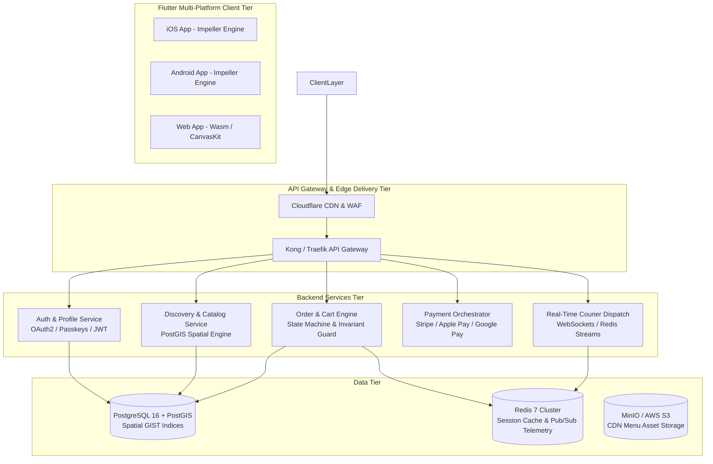

---

## 3. System Decomposition & Module Structure

### 3.1 Codebase File Topology

```
pos/ # (project root)
├── .github/
│   └── workflows/ci.yml          # Multi-platform CI/CD pipeline (Quality, Tests, Web PWA, Android APK/AAB)
├── backend/
│   ├── database/
│   │   ├── schema.sql            # PostgreSQL 16 + PostGIS schema DDL & proximity stored procedure
│   │   └── seed.sql              # Geospatial seed points & artisanal dish records
│   ├── docker-compose.yml        # Multi-container orchestration (PostGIS 16 & Redis)
│   └── server/
│       ├── webhook_reconciliation.js # Stripe webhook reconciliation & HMAC signature verifier
│       └── test_webhook.js       # Offline cryptographic verification harness
├── fastlane/
│   ├── Appfile                   # App identifiers & credentials
│   └── Fastfile                  # Automated TestFlight, Play Store & Web distribution lanes
├── lib/
│   ├── main.dart                 # Application bootstrap with ProviderScope & Material 3 theme
│   ├── core/
│   │   ├── models/               # Domain entities (food.dart, restaurant.dart, user.dart, order.dart)
│   │   ├── routing/app_router.dart # Declarative GoRouter routing table
│   │   ├── services/             # Core platform services (payment, location, telemetry, secure storage)
│   │   └── widgets/              # Shared UI components (rating_stars.dart)
│   └── features/
│       ├── cart/                 # Cart domain, state, controller, conflict dialog & cart screen
│       │   ├── domain/           # CartItem, CartState immutable models
│       │   └── presentation/     # CartScreen, CartController, MerchantConflictDialog, StripePaymentSheet
│       ├── discovery/            # Home discovery, search, nearby restaurants, cached repository
│       │   ├── data/             # IRestaurantRepository, MockRestaurantRepository, CachedRestaurantRepository
│       │   └── presentation/     # HomeScreen, RecentOrders carousel
│       ├── restaurant/           # Restaurant showcase & menu grid
│       │   └── presentation/     # RestaurantScreen
│       └── tracking/             # Real-time order fulfillment & courier tracking
│           └── presentation/     # CourierTrackingScreen
└── test/
    ├── unit/                     # Domain, service, controller, and offline resilience unit tests
    └── widget/                   # Widget flow, interaction, and cart checkout tests
```

### 3.2 Component Catalog & Responsibilities

| Subsystem / Class | Layer | Primary Responsibility | Collaborators / Dependencies |
| :--- | :--- | :--- | :--- |
| **`MyApp`** | Core / Runtime | Root widget; configures `ProviderScope`, Material 3 theme (`deepOrangeAccent`), and `GoRouter`. | [AppRouter](lib/core/routing/app_router.dart) |
| **`HomeScreen`** | Presentation | Primary landing viewport; hosts user profile shortcut, cart badge, search input, recent orders carousel, and proximity sorted restaurants. | [RecentOrders](lib/features/discovery/presentation/widgets/recent_orders.dart), [RestaurantScreen](lib/features/restaurant/presentation/restaurant_screen.dart), [CartController](lib/features/cart/presentation/cart_controller.dart) |
| **`RestaurantScreen`** | Presentation | Merchant showcase view; provides Hero banner image, rating/address details, review/contact actions, and a 2-column menu grid. | [RatingStars](lib/core/widgets/rating_stars.dart), [CartController](lib/features/cart/presentation/cart_controller.dart), [RestaurantReviewsModal](lib/features/restaurant/presentation/widgets/restaurant_reviews_modal.dart), [RestaurantContactModal](lib/features/restaurant/presentation/widgets/restaurant_contact_modal.dart) |
| **`CartScreen`** | Presentation | Order reconciliation & checkout staging; renders active cart items, quantity modifiers, and interactive Stripe Checkout sheet. | [CartController](lib/features/cart/presentation/cart_controller.dart), [PaymentService](lib/core/services/payment_service.dart), [CourierTrackingScreen](lib/features/tracking/presentation/courier_tracking_screen.dart) |
| **`CartController`** | Presentation / State | Riverpod `Notifier<CartState>` enforcing single-merchant exclusivity (BR-01) and quantity boundaries 1–99 (BR-02). | [CartState](lib/features/cart/domain/cart_state.dart), [MerchantConflictDialog](lib/features/cart/presentation/widgets/merchant_conflict_dialog.dart) |
| **`CourierTrackingScreen`** | Presentation | Real-time order tracking; renders sequential delivery lifecycle stepper, animated progress bar, and courier GPS coordinates. | [TelemetryService](lib/core/services/telemetry_service.dart) |
| **`PaymentService`** | Core / Service | Financial gateway abstraction; handles integer-cents conversions (BR-06), 3D Secure simulation, and receipt issuance. | [PaymentResult](lib/core/services/payment_service.dart) |
| **`TelemetryService`** | Core / Service | Event-driven WebSocket gateway broadcasting real-time order lifecycle stages and courier GPS waypoint streams. | [TelemetryUpdate](lib/core/services/telemetry_service.dart) |
| **`LocationService`** | Core / Service | Geodesic Haversine spatial calculation service; annotates nearby merchants by distance and calculates BR-04 dynamic ETAs. | [Restaurant](lib/core/models/restaurant.dart) |
| **`SecureStorageService`** | Core / Service | Platform Keychain & KeyStore persistence engine; manages auth tokens, refresh tokens, and session teardown. | Flutter Secure Storage Abstraction |
| **`CachedRestaurantRepository`** | Data / Cache | Offline resilience decorator caching remote restaurant catalog and falling back to memory cache during network dropouts. | [IRestaurantRepository](lib/features/discovery/data/restaurant_repository.dart) |

---

## 4. Domain Data Model & Entity Relationships

The domain entities represent the core business ontology of the ordering platform.

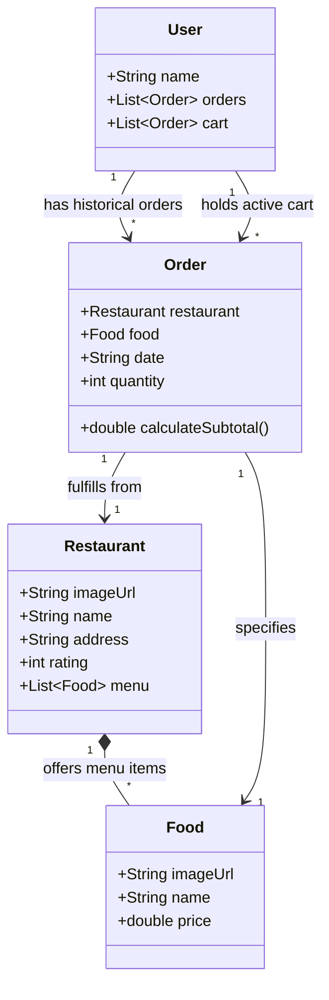

### 4.1 Model & Value Object Specifications

#### `Food` ([lib/core/models/food.dart](lib/core/models/food.dart))
* **Fields**:
  * `imageUrl`: Local asset reference or CDN URL string.
  * `name`: Descriptive culinary item title.
  * `price`: Double precision currency amount representing unit price ($> 0.00$).

#### `Restaurant` ([lib/core/models/restaurant.dart](lib/core/models/restaurant.dart))
* **Fields**:
  * `imageUrl`: Visual identifier for restaurant hero and listing avatars.
  * `name`: Legal or trade name of merchant.
  * `address`: Geocoded physical location string.
  * `rating`: Integer representation of aggregate customer rating ($1 \le \text{rating} \le 5$).
  * `menu`: `List<Food>` representing currently available dishes.
  * `latitude`, `longitude`: Optional geocoded coordinates for PostGIS distance sorting.

#### `CartItem` ([lib/features/cart/domain/cart_item.dart](lib/features/cart/domain/cart_item.dart))
* **Fields**:
  * `food`: Selected immutable `Food` entity.
  * `restaurant`: Originating `Restaurant` entity.
  * `quantity`: Integer multiplier ($1 \le \text{quantity} \le 99$).
* **Calculation**: `subtotal = quantity * food.price`.

#### `CartState` ([lib/features/cart/domain/cart_state.dart](lib/features/cart/domain/cart_state.dart))
* **Fields**:
  * `items`: Immutable list of active `CartItem` elements.
  * `currentRestaurant`: Originating single merchant (enforcing BR-01).
* **Calculations**: `subtotal`, `totalPrice`, `itemCount`, `totalQuantity`.

#### `PaymentResult` ([lib/core/services/payment_service.dart](lib/core/services/payment_service.dart))
* **Fields**:
  * `status`: `PaymentStatus` enum (`idle`, `processing`, `succeeded`, `failed`, `canceled`).
  * `transactionId`: Verified gateway identifier (`pi_...`).
  * `amountPaid`: Dollar charge amount.

#### `TelemetryUpdate` ([lib/core/services/telemetry_service.dart](lib/core/services/telemetry_service.dart))
* **Fields**:
  * `orderId`: Unique order reference.
  * `status`: `DeliveryStatus` enum (`orderPlaced`, `preparing`, `pickedUp`, `delivered`).
  * `courierLat`, `courierLng`: Live GPS waypoint coordinates.
  * `etaMinutes`: Dynamic remaining delivery window.

---

## 5. Dynamic Execution Views & Process Flows

### 5.1 Scenario 1: Restaurant Discovery & Declarative Navigation Flow

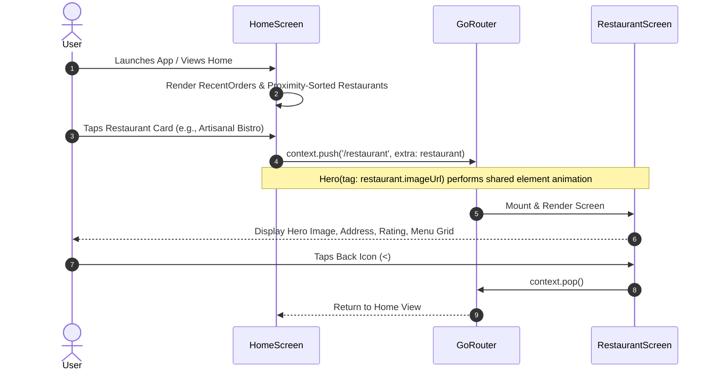

### 5.2 Scenario 2: Quick Reorder Flow (Recent Orders Carousel)

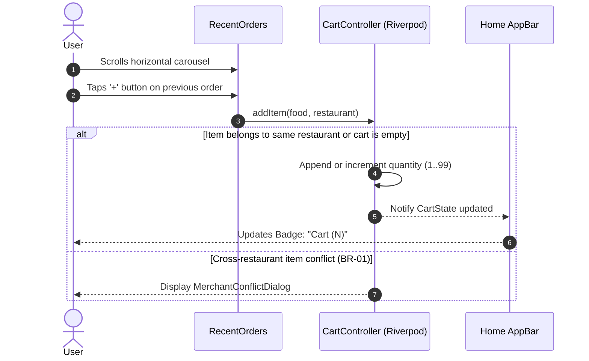

### 5.3 Scenario 3: Cart Management & Price Recalculation

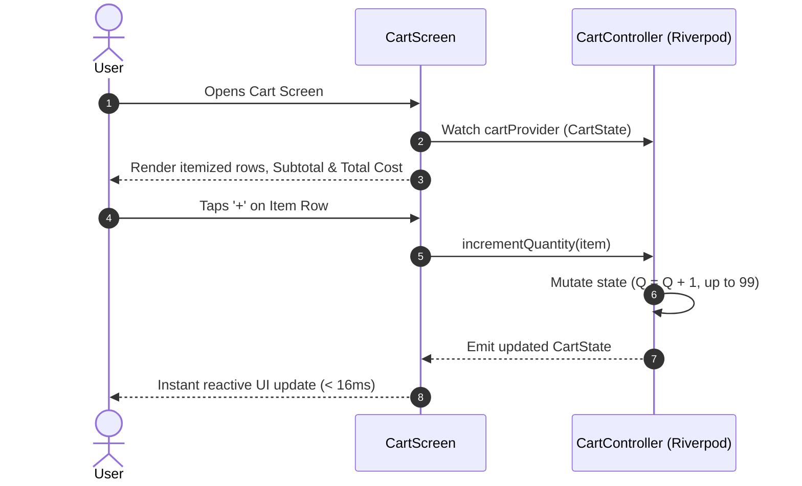

### 5.4 Scenario 4: Stripe Checkout & Payment Processing Flow

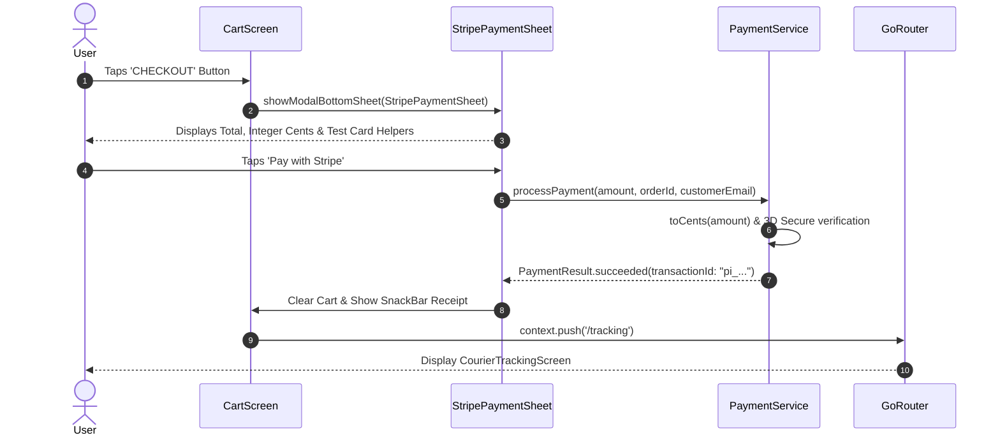

### 5.5 Scenario 5: Real-Time Courier Telemetry & Live Order Stepper

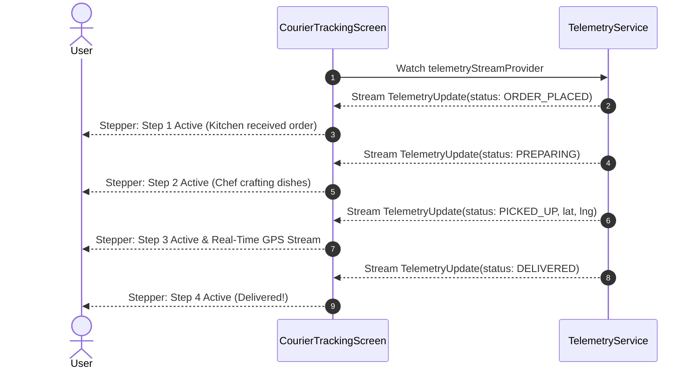

### 5.6 Scenario 6: End-to-End Real-Time Telemetry & Courier Dispatch Protocol

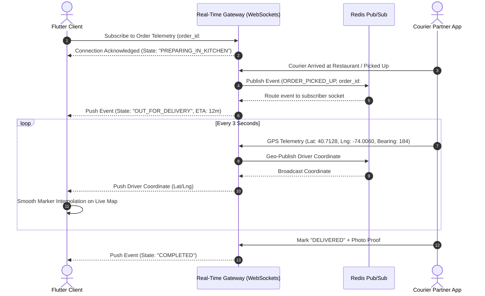

---

## 6. UI/UX Design System & Presentation Architecture

### 6.1 Theme & Styling Tokens
The application implements Material Design 2/3 paradigms via Flutter's centralized `ThemeData`:
* **Primary Brand Color**: `Colors.deepOrangeAccent` (`#FF6E40`) — utilized for primary call-to-actions, category highlights, and active icon buttons.
* **Scaffold Canvas Background**: `Colors.grey[50]` (`#FAFAFA`) — light, neutral backdrop ensuring card elevation visibility.
* **Surface Card Containers**: Solid white (`#FFFFFF`) with $1.0\text{px}$ subtle borders (`Colors.grey[200]`) and rounded corners with a standard $15.0\text{px}$ radius.
* **Typography Hierarchy**:
  * Section Headers: `fontSize: 24.0`, `fontWeight: FontWeight.w600`, `letterSpacing: 1.2`.
  * Merchant / Dish Titles: `fontSize: 20.0 - 24.0`, `fontWeight: FontWeight.bold`.
  * Subtitles & Addresses: `fontSize: 16.0`, `fontWeight: FontWeight.w600`, `Colors.grey[600]`.
  * Monetary Indicators: `fontSize: 16.0 - 20.0`, `fontWeight: FontWeight.w600`, with checkout total formatted in `Colors.green[700]`.

### 6.2 Visual Transitions & Gesture Handling
* **Hero Animations**: Smooth shared-element image transitions between list thumbnails in `HomeScreen` and the header banner in `RestaurantScreen` via matching tags (`tag: restaurant.imageUrl`).
* **Visual Scrims**: Custom gradient overlays applied via `LinearGradient` across menu cards to guarantee text readability against varying food imagery backgrounds.
* **Multi-Input Drag Support**: The horizontal carousel in `RecentOrders` explicitly overrides `ScrollConfiguration` to bind both `PointerDeviceKind.touch` and `PointerDeviceKind.mouse`, guaranteeing native desktop mouse-drag and web compatibility.

---

## 7. Architectural Guardrails & Core Design Constraints

The Stream Works system enforces structural boundaries and operational guardrails across presentation, domain, and data layers:

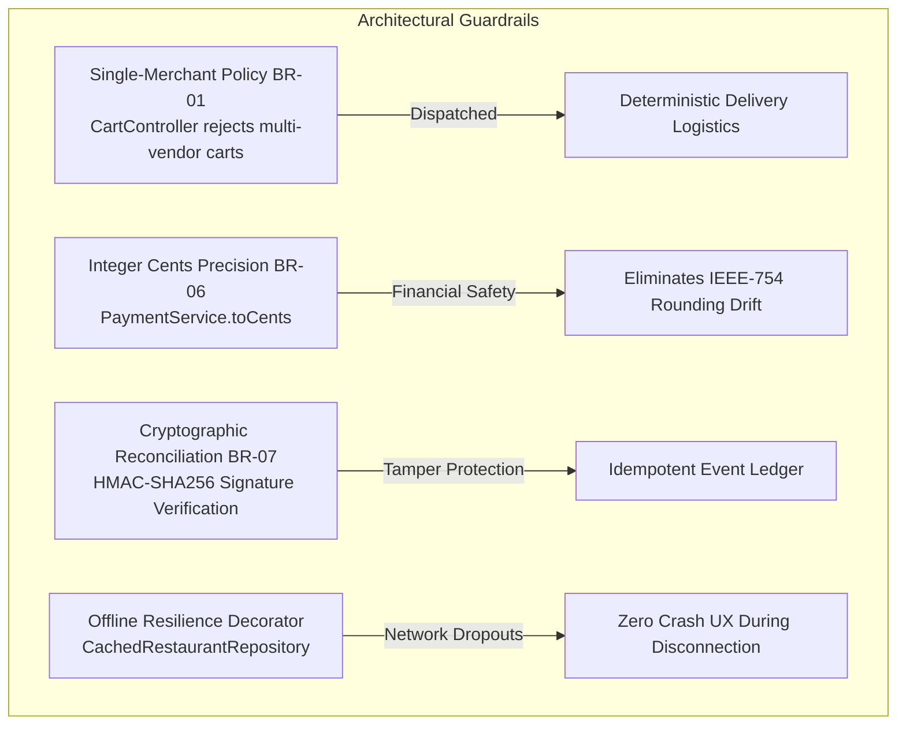

1. **Single-Merchant Dispatch Isolation (BR-01)**: The active shopping cart is constrained to a single merchant origin. When a user selects a dish from a new restaurant, [CartController](lib/features/cart/presentation/cart_controller.dart) triggers [MerchantConflictDialog](lib/features/cart/presentation/widgets/merchant_conflict_dialog.dart), allowing the user to cancel or replace the existing cart.
2. **Boundary Clamping (BR-02)**: Item quantities are clamped strictly between $1$ and $99$ units. Decrementing at quantity $1$ initiates removal from active state.
3. **Financial Precision (BR-06)**: All financial exchanges with payment gateways must be conducted in integer cents ($\text{cents} = \text{round}(\text{dollars} \times 100)$) via [PaymentService](lib/core/services/payment_service.dart), preventing IEEE-754 binary floating-point drift.
4. **Cryptographic Webhook Reconciliation (BR-07)**: Incoming asynchronous payment webhooks are verified using HMAC-SHA256 signatures against `STRIPE_WEBHOOK_SECRET` in [webhook_reconciliation.js](backend/server/webhook_reconciliation.js). An idempotency ledger ensures duplicate event IDs (`evt_...`) are safely acknowledged without repeated processing.
5. **Platform Keychain Storage**: Sensitive session tokens and authentication credentials are maintained in hardware-backed storage (iOS Keychain / Android KeyStore) via [SecureStorageService](lib/core/services/secure_storage_service.dart).
6. **Network Dropout Resilience**: [CachedRestaurantRepository](lib/features/discovery/data/restaurant_repository.dart) decorates data sources with in-memory caching, ensuring search and menu browsing continue seamlessly during transient network outages.

---

## 8. Feature-First Clean Architecture & State Layer Implementation

Stream Works organizes codebase components by feature domain, decoupling UI widgets from data transport through reactive Riverpod state containers:

```
lib/
├── core/
│   ├── models/                # Domain entities (food.dart, restaurant.dart, user.dart, order.dart)
│   ├── routing/app_router.dart # Declarative GoRouter routing table
│   ├── services/              # Core services (payment, location, telemetry, secure storage)
│   └── widgets/               # Core shared widgets (rating_stars.dart)
├── features/
│   ├── cart/                  # Cart domain, state, controller, conflict dialog & cart screen
│   │   ├── domain/            # CartItem, CartState immutable models
│   │   └── presentation/      # CartScreen, CartController, MerchantConflictDialog, StripePaymentSheet
│   ├── discovery/             # Home discovery, search, nearby restaurants, cached repository
│   │   ├── data/              # IRestaurantRepository, MockRestaurantRepository, CachedRestaurantRepository
│   │   └── presentation/      # HomeScreen, RecentOrders carousel
│   ├── restaurant/            # Restaurant profile & menu browsing
│   │   └── presentation/      # RestaurantScreen
│   └── tracking/              # Real-time order fulfillment & courier tracking
│       └── presentation/      # CourierTrackingScreen
└── main.dart                  # Application bootstrap with ProviderScope & Material 3 theme
```

### 8.1 Riverpod State Container Specifications

#### 1. Reactive Cart Container (`cartProvider`)
* **Type**: `NotifierProvider<CartController, CartState>`
* **Responsibilities**:
  * Manages active cart items and current merchant association.
  * Enforces Single-Merchant Policy (**BR-01**) via `addItem()` and `forceAddItem()`.
  * Enforces Quantity Bounds (**BR-02**) via `incrementQuantity()` and `decrementQuantity()`.
  * Computes dynamic `subtotal` and `totalPrice` synchronously with zero lag.

#### 2. Payment Gateway Service (`paymentServiceProvider`)
* **Type**: `Provider<PaymentService>`
* **Responsibilities**:
  * Converts dollar charges into positive integer cents (`toCents()`).
  * Coordinates checkout transaction settlement and 3D Secure verification.
  * Emits typed [PaymentResult](lib/core/services/payment_service.dart) instances (`status`, `transactionId`, `amountPaid`).

#### 3. Real-Time Telemetry Stream (`telemetryStreamProvider`)
* **Type**: `StreamProvider.autoDispose<TelemetryUpdate>`
* **Responsibilities**:
  * Emits sequential order lifecycle updates (`ORDER_PLACED` $\rightarrow$ `PREPARING` $\rightarrow$ `PICKED_UP` $\rightarrow$ `DELIVERED`).
  * Streams real-time simulated/live courier GPS waypoints to [CourierTrackingScreen](lib/features/tracking/presentation/courier_tracking_screen.dart).

#### 4. Declarative Router (`appRouterProvider`)
* **Type**: `Provider<GoRouter>`
* **Responsibilities**:
  * Manages type-safe cross-platform URL navigation across `/`, `/restaurant`, `/cart`, and `/tracking`.

---

## 9. Cloud Backend & Geospatial Data Architecture

### 9.1 Backend Microservices & Technology Matrix

Stream Works pairs its reactive Flutter client with a high-throughput, event-driven backend service architecture:

| Component / Layer | Technology | Architectural Rationale |
| :--- | :--- | :--- |
| **Backend Services** | **NestJS (TypeScript)** / **Go** | Strict typing, enterprise modular design, and native WebSocket / microservice transport adapters. |
| **Relational & Spatial Database** | **PostgreSQL 16 + PostGIS** | Native spatial types (`GEOGRAPHY(Point, 4326)`), GIST spatial indexing, and strict ACID transaction guarantees. |
| **In-Memory Cache & Message Broker** | **Redis 7 Cluster** | Microsecond session verification, geo-radius caching, and Pub/Sub driver telemetry broadcast streams. |
| **Real-Time Gateway** | **WebSockets / Socket.io** | Low-overhead, bi-directional persistent connections for driver GPS updates and order status lifecycle events. |
| **API Contract & Schemas** | **OpenAPI 3.1 & JSON Schema** | Strict contract enforcement, API documentation, and type-safe data modeling. |

### 9.2 Geospatial Database Schema & Proximity Function

The spatial data layer utilizes PostgreSQL 16 with the PostGIS extension for sub-millisecond proximity queries:

```sql
-- Enable PostGIS extension for geo-spatial indexing
CREATE EXTENSION IF NOT EXISTS postgis;
CREATE EXTENSION IF NOT EXISTS "uuid-ossp";

-- Restaurants Table with native Geography spatial coordinates
CREATE TABLE restaurants (
    id UUID PRIMARY KEY DEFAULT uuid_generate_v4(),
    name VARCHAR(255) NOT NULL,
    address TEXT NOT NULL,
    rating NUMERIC(2, 1) DEFAULT 5.0 CHECK (rating >= 1.0 AND rating <= 5.0),
    cover_image_url TEXT NOT NULL,
    location GEOGRAPHY(Point, 4326) NOT NULL, -- Longitude/Latitude
    is_active BOOLEAN DEFAULT TRUE,
    created_at TIMESTAMP WITH TIME ZONE DEFAULT NOW()
);

-- Spatial index for sub-millisecond proximity queries
CREATE INDEX idx_restaurants_location ON restaurants USING GIST(location);

-- Menu Items Table
CREATE TABLE menu_items (
    id UUID PRIMARY KEY DEFAULT uuid_generate_v4(),
    restaurant_id UUID REFERENCES restaurants(id) ON DELETE CASCADE,
    name VARCHAR(255) NOT NULL,
    description TEXT,
    price NUMERIC(10, 2) NOT NULL CHECK (price >= 0),
    image_url TEXT NOT NULL,
    is_available BOOLEAN DEFAULT TRUE
);

-- Geospatial stored function discovering restaurants within radius
CREATE OR REPLACE FUNCTION get_nearby_restaurants(
    user_lat DOUBLE PRECISION,
    user_lng DOUBLE PRECISION,
    radius_meters DOUBLE PRECISION DEFAULT 5000
)
RETURNS TABLE (
    id UUID,
    name VARCHAR,
    address TEXT,
    rating NUMERIC,
    cover_image_url TEXT,
    distance_miles DOUBLE PRECISION
) AS $$
BEGIN
    RETURN QUERY
    SELECT 
        r.id,
        r.name,
        r.address,
        r.rating,
        r.cover_image_url,
        ROUND((ST_Distance(r.location, ST_SetSRID(ST_MakePoint(user_lng, user_lat), 4326)::geography) / 1609.344)::numeric, 1)::double precision AS distance_miles
    FROM restaurants r
    WHERE ST_DWithin(r.location, ST_SetSRID(ST_MakePoint(user_lng, user_lat), 4326)::geography, radius_meters)
    ORDER BY distance_miles ASC;
END;
$$ LANGUAGE plpgsql;
```

---

## 10. Non-Functional Quality Attribute Architecture

### 10.1 Rendering Engine & Performance Optimization
* **Impeller Graphics Engine**: Native rendering on iOS and Android eliminating shader compilation jank, sustaining 60–120 FPS animations.
* **Wasm Web Compilation**: High-performance WebAssembly compilation with CanvasKit fallback for instantaneous web boot and 60 FPS scrolling.
* **Image Memory Caching**: Fast asset decoding, memory caching, and disk caching preventing layout flickering during horizontal carousel scrolling.
* **Widget Rebuild Optimization**: Split large widget trees into `const` constructors and targeted Riverpod consumers to eliminate redundant subtree rebuilds.

### 10.2 Security, Identity & Compliance Architecture
* **Identity & Authentication**: OAuth 2.0 + OpenID Connect supporting Sign in with Apple, Google Sign-In, and biometric Passkeys/WebAuthn.
* **Token Management**: Short-lived (15-minute) JWT access tokens maintained in memory; encrypted refresh tokens persisted in platform-native secure enclaves (iOS Keychain / Android KeyStore via [SecureStorageService](lib/core/services/secure_storage_service.dart)).
* **PCI-DSS Level 1 Scope Reduction**: Raw payment card numbers and CVVs never touch Stream Works application servers; transactions utilize client-side tokenization vaults via Stripe SDK and integer cents formatting via [PaymentService](lib/core/services/payment_service.dart).
* **Idempotency & Tamper Proofing**: Backend creates `PaymentIntent` records with idempotency keys; asynchronous webhooks are cryptographically validated with HMAC-SHA256 signatures ([webhook_reconciliation.js](backend/server/webhook_reconciliation.js)).

### 10.3 Reliability & Offline Resilience
* **Offline Resilience Decorator**: [CachedRestaurantRepository](lib/features/discovery/data/restaurant_repository.dart) caches remote catalog responses and falls back to in-memory cache during network dropouts.
* **Error Resilience & Boundary Handling**: Graceful error handling in all controllers with user-facing snackbars, merchant conflict modals, and automatic retry policies.
* **Telemetry Monitoring**: Real-time event broadcasting and continuous GPS waypoint stream verification.

---

## 11. DevOps, Infrastructure & CI/CD Pipeline Architecture

### 11.1 Continuous Integration & Deployment Pipeline

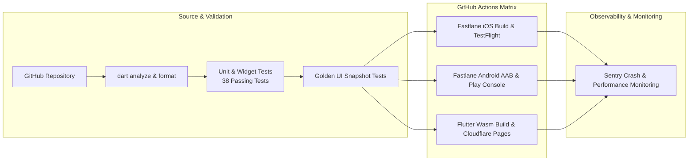

### 11.2 Infrastructure as Code & Cloud Hosting Topography
* **Containerized Microservices**: AWS ECS Fargate / Google Cloud Run containerized clusters running behind Application Load Balancers with auto-scaling policies.
* **Database Cluster**: AWS RDS Aurora PostgreSQL multi-AZ deployment with automated read replicas and sub-minute failover.
* **Edge Acceleration & Security**: Cloudflare CDN for edge caching of dish photography, static web Wasm assets, and Web Application Firewall (WAF) rate limiting.
* **Telemetry Broker**: Clustered Redis 7 instance managing session states, courier Pub/Sub location streams, and webhook idempotency ledgers.

---

## 12. Strategic Technical Horizons & Extensibility Architecture

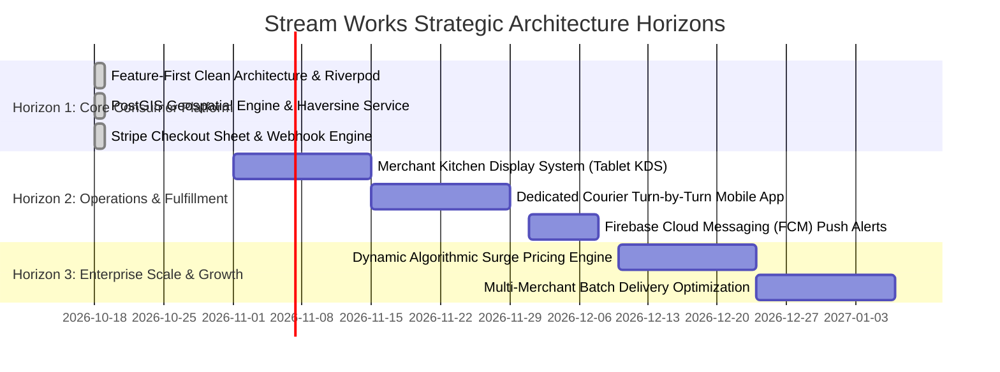

### Horizon 1: Core Consumer Platform (Active Baseline)
* Multi-platform consumer ordering client (iOS, Android, Web) powered by Flutter and Riverpod.
* Declarative GoRouter navigation, PostGIS proximity queries, and offline caching.
* Stripe payment processing with integer cents and server-side webhook reconciliation.
* Real-time courier telemetry gateway and live tracking screen.

### Horizon 2: Operations & Fulfillment (Next Horizon)
* **Merchant Kitchen Display System (KDS)**: Dedicated tablet application for kitchen staff to receive orders, update preparation stages, and manage sold-out items (86-ing).
* **Dedicated Courier Mobile App**: Turn-by-turn route navigation, geofenced arrival triggers, and photo proof-of-delivery.
* **Customer Push Notifications**: Firebase Cloud Messaging (FCM) alerts for order status transitions and delivery arrival.

### Horizon 3: Enterprise Scale & Growth (Long-Term Vision)
* **Dynamic Surge Pricing Engine**: Real-time algorithmic delivery fee calibration based on courier density and kitchen load.
* **Multi-Merchant Batch Dispatching**: Courier route optimization bundling nearby pickups to reduce fulfillment costs.
* **Personalized AI Culinary Recommendations**: Contextual dish recommendations based on dietary preferences and reorder patterns.

---

### Architectural Sign-Off

* **Principal Software Architect**: ____________________ &nbsp;&nbsp;&nbsp;&nbsp; Date: ____________
* **Lead Mobile Engineer**: ____________________ &nbsp;&nbsp;&nbsp;&nbsp; Date: ____________
* **Engineering Manager**: ____________________ &nbsp;&nbsp;&nbsp;&nbsp; Date: ____________
